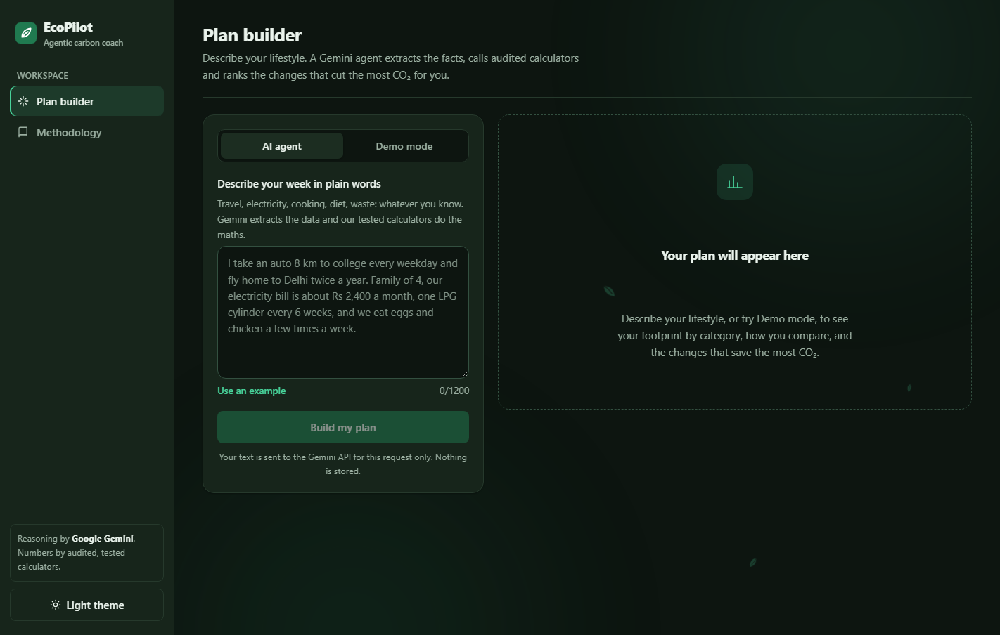
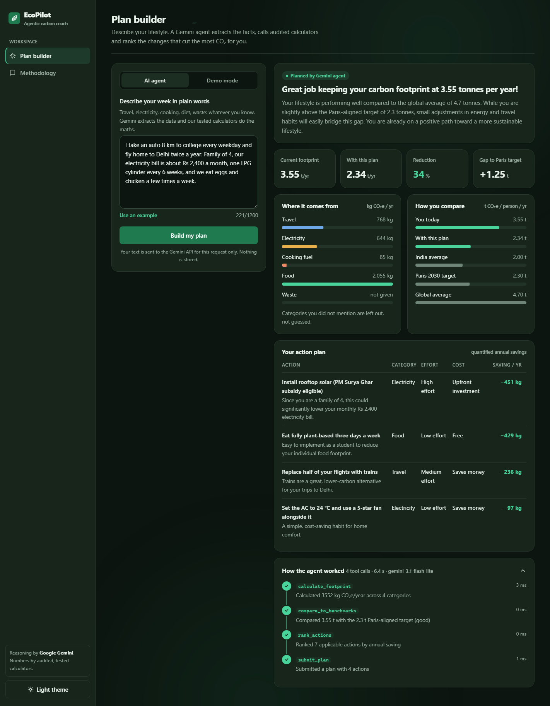
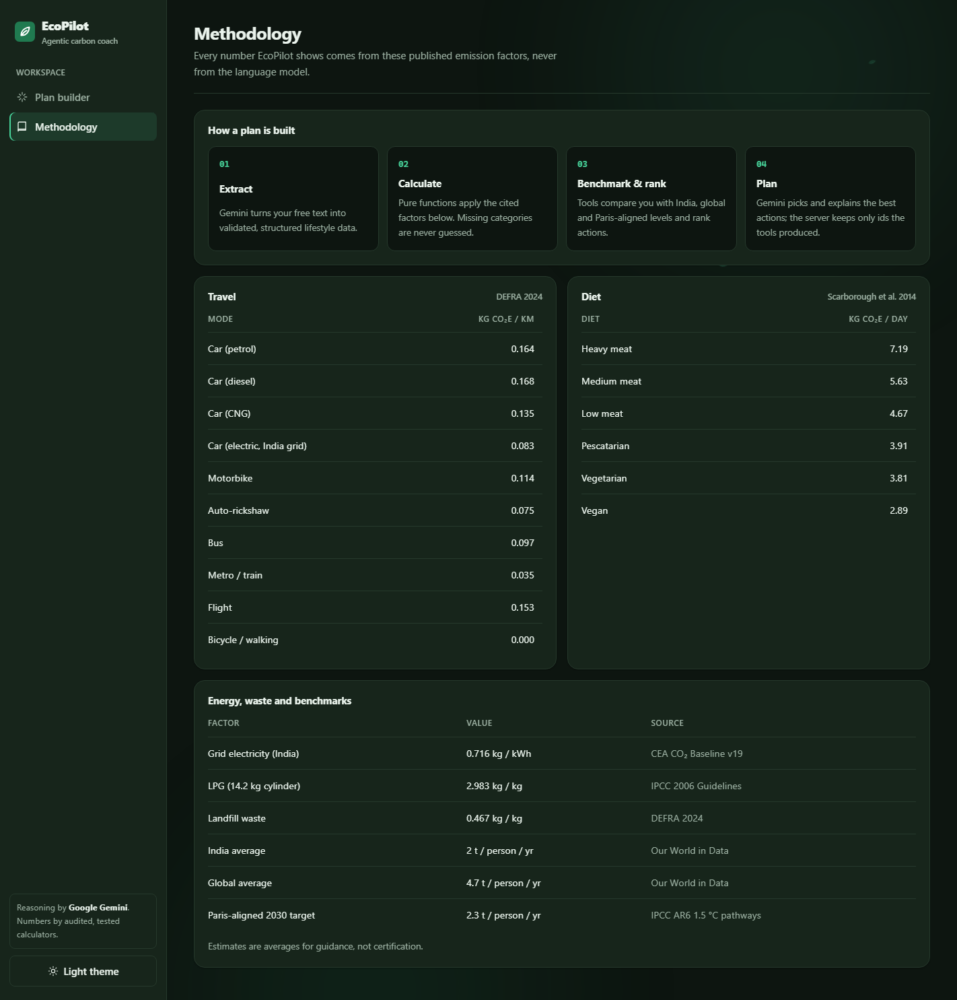
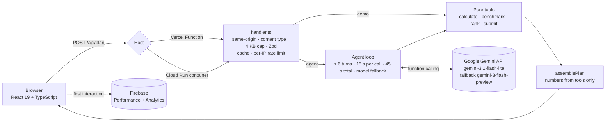

# 🌱 EcoPilot: Agentic AI Carbon Coach

> **Describe your week in plain words. A Google Gemini agent turns it into a measurable, personalised carbon-reduction plan, and every number comes from audited, tested code, never from the language model.**

[](https://github.com/chinmaymeshram1-wq/promptwar/actions/workflows/ci.yml)


**Live demo:** **https://promptwar-opal.vercel.app** (try **Demo mode** for an instant result, or **AI agent** mode for a Gemini-planned one)
· **Domain:** Sustainability · **Challenge:** Build Beyond AI, PromptWars Hackathon 2026 (VYOM Club, NMIET)

---

## At a glance

|                        |                                                                                                                                                                                                 |
| ---------------------- | ----------------------------------------------------------------------------------------------------------------------------------------------------------------------------------------------- |
| **Problem**            | People want to cut emissions but do not know where theirs come from or which change matters most for _them_. Calculators give a number, not a plan.                                             |
| **Solution**           | An agentic app: Gemini extracts structured data from free text and orchestrates four deterministic tools that calculate, benchmark, rank and project, then explains a personalised plan.        |
| **Why it is reliable** | The model never produces a number. Tools ignore model-supplied numbers, all inputs are schema-validated, a fallback model and a deterministic narrative mean users always get a correct plan.   |
| **Google technology**  | Gemini API (function-calling agent, system instructions, safety settings), Firebase Performance Monitoring and Analytics, Cloud Run-ready container verified in CI.                             |
| **Evidence**           | Lighthouse desktop 100 in every category · axe 0 violations · 100 tests, 92.5% coverage · 0 npm audit vulnerabilities · 14-check end-to-end smoke test against the container and the live site. |

## Screenshots

| Plan builder                                                                                       | Agent results                                                                                    |
| -------------------------------------------------------------------------------------------------- | ------------------------------------------------------------------------------------------------ |
|  |  |



## How it works

You write one paragraph, for example _"I ride my motorbike 12 km to college every weekday, our electricity bill is ₹2,000 a month, we eat chicken twice a week."_ Then the agent:

1. **Extracts** structured lifestyle data from the text (`calculate_footprint`, validated with Zod; invalid arguments are returned to the model so it **self-corrects**).
2. **Calculates** the annual footprint per category from published emission factors. Missing categories are reported, **never guessed**.
3. **Benchmarks** it against the India average, the global average and the 2030 Paris-aligned target (`compare_to_benchmarks`).
4. **Ranks** every applicable action by quantified annual CO₂ saving (`rank_actions`).
5. **Plans:** Gemini picks the most practical actions for _this_ person and explains them (`submit_plan`). Unknown action ids are dropped.
6. **Projects** the footprint after the plan with overlap-safe maths.

The UI shows the full **agent trace**: each tool call, whether it succeeded, timing, model calls and **tokens used**.

### Design principle: _the AI decides, the code computes_

LLMs are excellent at understanding messy language and prioritising, and unreliable at arithmetic. So:

- Every figure shown comes from pure, unit-tested functions in [`shared/tools.ts`](shared/tools.ts).
- `compare_to_benchmarks` and `rank_actions` take **no arguments from the model**. They read server-side state, so a prompt-injected model cannot fabricate results.
- User text is wrapped in delimiters and labelled untrusted in the system instruction.

## Architecture



The same framework-agnostic handler runs on **Vercel**, in the **Cloud Run container**, and in the **Vite dev server**, and it is unit-tested directly. See [docs/ARCHITECTURE.md](docs/ARCHITECTURE.md) for the request sequence and failure handling, and [docs/openapi.yaml](docs/openapi.yaml) for the API contract.

### Reliability: every request gets a correct answer

| Source                      | When                                              | What happens                                                                               |
| --------------------------- | ------------------------------------------------- | ------------------------------------------------------------------------------------------ |
| `gemini`                    | Normal path                                       | Full agent loop; Gemini writes the headline, insight and per-action notes                  |
| `gemini` via fallback model | Primary model fails (quota, overload, retired)    | The same turn is retried once on the fallback model; the plan records which model answered |
| `fallback`                  | Data was extracted, then the model failed         | Deterministic narrative; numbers are identical                                             |
| `demo`                      | User picks Demo mode, or no API key is configured | Curated profiles through the same tools with zero model calls                              |
| `cached`                    | Same description asked again                      | Served from a TTL/LRU cache in milliseconds with 0 tokens                                  |

## Google technology used

| Technology                          | How EcoPilot uses it                                                                                                                                                                                                                                                                                                | Where                                          |
| ----------------------------------- | ------------------------------------------------------------------------------------------------------------------------------------------------------------------------------------------------------------------------------------------------------------------------------------------------------------------- | ---------------------------------------------- |
| **Gemini API** (`@google/genai` v2) | Multi-turn function-calling agent (`ANY` mode, four tools with JSON-Schema parameters), system instructions, **safety settings**, per-call **token accounting**, thought-signature-preserving history                                                                                                               | [`server/agent.ts`](server/agent.ts)           |
| **Benchmarked model selection**     | `gemini-3.1-flash-lite` by default (a full plan in about 6–20 s, generous quota) with automatic fallback to `gemini-3-flash-preview`. We measured that `gemini-flash-latest` hung on tool calls, 2.5 models return 404 for new keys, and `gemini-3.5-flash` exhausts its free quota quickly. Both are configurable. | [`server/gemini.ts`](server/gemini.ts)         |
| **Firebase Performance Monitoring** | Real-user page-load and `/api/plan` network traces                                                                                                                                                                                                                                                                  | [`src/telemetry.ts`](src/telemetry.ts)         |
| **Firebase Analytics (GA4)**        | `plan_generated` / `plan_failed` events with aggregate fields only, never user text                                                                                                                                                                                                                                 | [`src/telemetry.ts`](src/telemetry.ts)         |
| **Google Cloud Run**                | Production container: multi-stage [`Dockerfile`](Dockerfile), non-root, `$PORT`, `/healthz`, graceful SIGTERM. **CI builds the image and smoke-tests it on every push.**                                                                                                                                            | [`server/standalone.ts`](server/standalone.ts) |

## Evaluation criteria → evidence

| Criterion             | What we did                                                                                                                                                                                                                                                                                                                                                                                                                                                   | Where to look                                                                    |
| --------------------- | ------------------------------------------------------------------------------------------------------------------------------------------------------------------------------------------------------------------------------------------------------------------------------------------------------------------------------------------------------------------------------------------------------------------------------------------------------------- | -------------------------------------------------------------------------------- |
| **Security**          | Server-only API key · same-origin enforcement (403) · prompt-injection boundary · numbers never from the model · Zod on every input and tool call · Gemini safety settings · per-IP rate limit, 4 KB body cap, 1,200-char input cap · CSP **without `unsafe-inline`**, HSTS, `nosniff`, `X-Frame-Options`, Permissions-Policy, COOP · generic errors with request ids · path-traversal-safe static server · non-root container · 0 audit findings, Dependabot | [`SECURITY.md`](SECURITY.md), [`server/`](server/), [`vercel.json`](vercel.json) |
| **Efficiency**        | Response cache (0 tokens on repeats) · **token usage measured per plan** (about 3–4.5k tokens) · bounded agent (≤ 6 turns) · parallel tool calls in one turn · demo mode with zero model calls · warm-instance client reuse · 78 KB gzip initial JS with code-split views, lazy animation engine and lazy Firebase                                                                                                                                            | [`server/cache.ts`](server/cache.ts), [`server/agent.ts`](server/agent.ts)       |
| **Technology**        | TypeScript strict (+ `noUncheckedIndexedAccess`), React 19, Motion 14, Vite 8, Zod 4, Vercel Functions, Docker, **type-aware ESLint** (`recommendedTypeChecked` + `stylisticTypeChecked`), Prettier, GitHub Actions, Dependabot                                                                                                                                                                                                                               | [`eslint.config.js`](eslint.config.js), [`.github/`](.github/)                   |
| **Performance**       | Lighthouse desktop **100** (FCP 0.4 s, Speed Index 0.6 s, TBT 0 ms, CLS 0) · immutable asset caching · system fonts · CSS-only charts · first-paint content rendered without animation delay · tools run in < 1 ms                                                                                                                                                                                                                                            | [Measured quality](#measured-quality-live-site)                                  |
| **Google technology** | Gemini agent, Firebase Performance and Analytics, Cloud Run container                                                                                                                                                                                                                                                                                                                                                                                         | [Google technology used](#google-technology-used)                                |
| **Testing**           | **100 tests, 92.5% coverage, CI-enforced floors**: calculators, schema bounds, agent loop with a scripted fake Gemini (injection, self-correction, unknown tools, turn budget, model fallback, token accounting), HTTP hardening, cache, rate limiter, static server and traversal attacks, UI flows with axe. Plus a **14-check end-to-end smoke test** run against the built container in CI                                                                | [`tests/`](tests/), [`scripts/smoke.mjs`](scripts/smoke.mjs)                     |
| **Accessibility**     | Lighthouse 100 · axe 0 violations in both themes (contrast included) · semantic landmarks, skip link, labelled controls, `aria-live` status, `role="alert"` errors, focus moved to results and page titles, keyboard-operable everything, visible focus, `prefers-reduced-motion`                                                                                                                                                                             | [`tests/app.test.tsx`](tests/app.test.tsx)                                       |
| **Documentation**     | This README, [architecture guide](docs/ARCHITECTURE.md), [OpenAPI 3.1 spec](docs/openapi.yaml), [security policy](SECURITY.md), [contributing guide](CONTRIBUTING.md), [changelog](CHANGELOG.md), cited emission factors                                                                                                                                                                                                                                      | [`docs/`](docs/)                                                                 |

## Measured quality (live site)

Measured against **https://promptwar-opal.vercel.app** on 23 Oct 2026.

| Check                                                                        | Result                                                                                                     |
| ---------------------------------------------------------------------------- | ---------------------------------------------------------------------------------------------------------- |
| Lighthouse 13.5, desktop                                                     | **Performance 100 · Accessibility 100 · Best Practices 100 · SEO 100 · Agentic Browsing 100**              |
| Lighthouse 13.5, mobile (slow 4G emulation)                                  | Performance 99 · Accessibility 100 · Best Practices 100 · SEO 100 · Agentic Browsing 100 (TBT 0 ms, CLS 0) |
| axe-core in a real browser, colour contrast included                         | **0 violations** on landing, results and methodology, dark and light                                       |
| Browser console under the production CSP                                     | **0 errors, 0 CSP violations**                                                                             |
| End-to-end smoke test (`npm run smoke -- https://promptwar-opal.vercel.app`) | **13/13 checks pass** on the live site; 14/14 on the container in CI                                       |
| End-to-end AI run through the UI                                             | Gemini plan with 4 tool calls; about 3–4.5k tokens; repeats served from cache                              |
| `npm audit`                                                                  | **0 vulnerabilities**                                                                                      |

## Emission factors and sources

| Factor                 | Value                                                                   | Source                                                   |
| ---------------------- | ----------------------------------------------------------------------- | -------------------------------------------------------- |
| Petrol car             | 0.164 kg CO₂e / km                                                      | UK DESNZ/DEFRA GHG conversion factors 2024               |
| Motorbike              | 0.114 kg CO₂e / km                                                      | DEFRA 2024                                               |
| Bus / metro            | 0.097 / 0.035 kg CO₂e / passenger-km                                    | DEFRA 2024                                               |
| Flight                 | 0.153 kg CO₂e / passenger-km                                            | DEFRA 2024 (incl. radiative forcing)                     |
| India grid electricity | 0.716 kg CO₂e / kWh                                                     | Central Electricity Authority, CO₂ Baseline Database v19 |
| LPG                    | 2.983 kg CO₂e / kg (14.2 kg cylinder)                                   | IPCC 2006 Guidelines                                     |
| Diets                  | 2.89 (vegan) to 7.19 (heavy meat) kg CO₂e / day                         | Scarborough et al. 2014, _Climatic Change_               |
| Benchmarks             | India 2.0 t, global 4.7 t, 2030 Paris-aligned 2.3 t per person per year | Our World in Data; IPCC AR6                              |

All factors live in [`shared/factors.ts`](shared/factors.ts) and are rendered on the in-app Methodology page from that same module.

## Getting started

```bash
git clone https://github.com/chinmaymeshram1-wq/promptwar.git
cd promptwar
npm ci
cp .env.example .env.local   # GEMINI_API_KEY is optional: demo mode works without it
npm run dev                  # http://localhost:5173, with /api/plan mounted
```

| Script                                   | Purpose                                             |
| ---------------------------------------- | --------------------------------------------------- |
| `npm run dev`                            | Vite dev server with the real API handler           |
| `npm run check`                          | Type-aware lint, type-check and tests               |
| `npm run coverage`                       | Tests with coverage floors                          |
| `npm run build` / `npm run build:server` | Client bundle / Cloud Run server bundle             |
| `npm start`                              | Run the production server on `$PORT` (default 8080) |
| `npm run smoke -- <url> [--container]`   | End-to-end checks against any deployment            |

### Deploy to Google Cloud Run

```bash
gcloud run deploy ecopilot --source . --region asia-south1 --allow-unauthenticated \
  --set-env-vars GEMINI_API_KEY=YOUR_KEY \
  --set-build-env-vars VITE_FIREBASE_CONFIG='{"apiKey":"…","projectId":"…","appId":"…"}'
```

The image is built from the [`Dockerfile`](Dockerfile), listens on `$PORT`, runs as a non-root user and exposes `/healthz`.

### Deploy to Vercel

Import the repository (preset **Vite** from `vercel.json`), add `GEMINI_API_KEY` and optionally `VITE_FIREBASE_CONFIG`, then deploy.

## Project structure

```text
api/plan.ts            Vercel Function entry
server/                agent loop, HTTP policy, cache, rate limit, Gemini client, Cloud Run server
shared/                emission factors, pure tools, Zod schemas, demo profiles (used by client and server)
src/                   React UI, Motion variants, telemetry
tests/                 100 unit, integration and UI accessibility tests
scripts/smoke.mjs      end-to-end checks against a running deployment
docs/                  architecture guide, OpenAPI spec, screenshots
Dockerfile             Cloud Run container
```

## Limitations and roadmap

- Emission factors are averages; results are guidance, not certification.
- The cache and rate limiter are per instance; for multi-region scale, move them to Firestore or Memorystore.
- Next: Firebase Auth and Firestore to track progress over months, bill-photo upload using Gemini's multimodal input, and state-level grid factors for India.

## Disclosure

Original work built during the hackathon. Open-source libraries: React, Vite, Zod, `@google/genai`, Firebase JS SDK, Motion, Vitest, Testing Library, axe-core, ESLint, typescript-eslint and Prettier. Development was AI-assisted (Claude Code), as allowed by the rules on tools and frameworks.

## License

[MIT](LICENSE)
