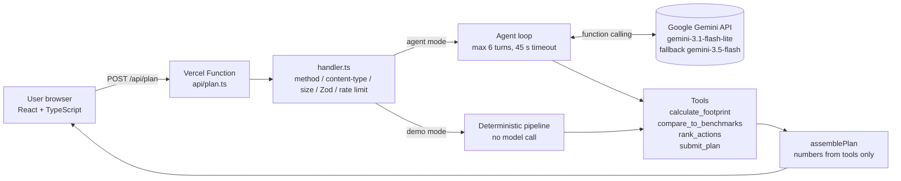

# 🌱 EcoPilot: Agentic AI Carbon Coach

> **Describe your lifestyle in plain words. A Gemini agent turns it into a measurable, personalised carbon-reduction plan, and every number comes from audited, tested code, not from the LLM.**

[](https://github.com/chinmaymeshram1-wq/promptwar/actions/workflows/ci.yml)


**Live demo:** **https://promptwar-opal.vercel.app** (try Demo mode for an instant result, or AI agent mode for a Gemini-planned one) · **Domain:** Sustainability · Built for PromptWars Hackathon 2026 (VYOM Club, NMIET)

---

## The problem

Most people want to cut their carbon footprint but do not know **where their emissions actually come from** or **which change matters most for them**. Generic tips ("turn off the lights") ignore the real numbers: for a frequent flyer, flights can be 60%+ of the total; for a car commuter, it is the daily drive. Carbon calculators exist, but they need long forms and give a number, not a plan.

## The solution

EcoPilot is an **agentic AI application**. You write one paragraph, for example _"I drive 25 km to work, our family of 3 uses 250 units of electricity a month, we eat chicken most days"_, and the agent:

1. **Extracts** structured lifestyle data from free text (Gemini reasoning over natural language).
2. **Calculates** the annual footprint per category with published emission factors (deterministic tool).
3. **Benchmarks** it against the India average, the global average and the 2030 Paris-aligned target (deterministic tool).
4. **Ranks** every applicable action by quantified annual CO₂ saving (deterministic tool).
5. **Plans**: Gemini picks the most practical 3–5 actions for _this_ person and explains them.
6. **Projects** your footprint after the plan, with overlap-safe maths.

The UI shows the full **agent trace** (each tool call and what it returned) so the reasoning is transparent.

### Design principle: _the AI decides, the code computes_

LLMs are good at understanding messy language and prioritising. They are bad at arithmetic and can be manipulated. So in EcoPilot:

- Gemini **never produces a number shown to the user**. Footprints, savings and projections come from pure, unit-tested functions in [`shared/tools.ts`](shared/tools.ts).
- Tools that need numbers (`compare_to_benchmarks`, `rank_actions`) take **no arguments from the model**. They read server-side state, so a prompt-injected model cannot fabricate results.
- Any action id the model invents is dropped. Any invalid tool argument is rejected by a Zod schema and returned to the model as an error so it can **self-correct**.

## Interface

- **Dark-first SaaS layout** with a sidebar (Plan builder, Methodology), consistent page headers and a two-pane workspace: input on the left, live dashboard on the right.
- **Dashboard:** summary, four animated KPI cards (current, projected, reduction, gap to the Paris target), category and benchmark bar charts, a ranked action table and an expandable agent timeline.
- **Honest states:** an empty state, an in-flight progress timeline with real elapsed time, error alerts with a Demo-mode hint, and failed tool calls shown as failed (from the server's per-step `ok` flag).
- **Motion:** short page and panel entrances, staggered cards, count-up KPIs, growing bars, a sliding nav and segmented-control indicator, and a quietly animated canopy background. Micro-interactions take 150–250 ms and transitions 250–400 ms. Everything is compositor-friendly and switches off under `prefers-reduced-motion`.
- **Methodology page:** renders every emission factor directly from `shared/factors.ts`, the same module the calculators use.

## Architecture



| Layer          | Files                                                                                  | Responsibility                                                        |
| -------------- | -------------------------------------------------------------------------------------- | --------------------------------------------------------------------- |
| UI             | [`src/`](src/)                                                                         | Accessible form, results, charts (CSS, no chart library), agent trace |
| API            | [`api/plan.ts`](api/plan.ts), [`server/http.ts`](server/http.ts)                       | Web-standard Vercel Function adapter                                  |
| Request policy | [`server/handler.ts`](server/handler.ts), [`server/rateLimit.ts`](server/rateLimit.ts) | Validation, limits, error mapping                                     |
| Agent          | [`server/agent.ts`](server/agent.ts), [`server/gemini.ts`](server/gemini.ts)           | Gemini function-calling loop, tool dispatch, fallback                 |
| Domain         | [`shared/tools.ts`](shared/tools.ts), [`shared/factors.ts`](shared/factors.ts)         | Pure calculators and cited emission factors                           |
| Contracts      | [`shared/schemas.ts`](shared/schemas.ts)                                               | Zod schemas shared by client, server and model tools                  |

### Reliability: three ways to a result

| Source     | When                                                                 | What happens                                                                                         |
| ---------- | -------------------------------------------------------------------- | ---------------------------------------------------------------------------------------------------- |
| `gemini`   | Normal path                                                          | Full agent loop; Gemini writes the headline, insight and per-action notes                            |
| `fallback` | Gemini extracted data but then failed, timed out or ran out of turns | The deterministic narrative is used; the user still gets a complete, correct plan                    |
| `demo`     | User picks **Demo mode**, or no API key is configured                | Curated profiles run through the same tools with zero model calls; judges can evaluate without a key |

## Google technology used

- **Gemini API** via the official [`@google/genai`](https://www.npmjs.com/package/@google/genai) SDK (v2).
- **Function calling** in `ANY` mode with four declared tools and JSON-Schema parameters (`parametersJsonSchema`).
- **System instructions** that set a tool order, data hygiene ("never guess missing categories") and an injection boundary.
- **Multi-turn agent loop** that returns tool results as `functionResponse` parts and preserves model content (including thought signatures) between turns.
- **Benchmarked model choice:** `gemini-3.1-flash-lite` by default (a full 4-turn plan in about 6 s, with generous free-tier quota) and **automatic fallback** to `gemini-3.5-flash` if a call fails (quota, overload or a retired model). The plan records which model answered. We measured that the moving `gemini-flash-latest` alias hung on tool calls and that 2.5 models return 404 for new keys. Both models can be set with `GEMINI_MODEL` and `GEMINI_FALLBACK_MODEL`.
- **Resilience:** a 45 s abort budget enforced on every call, and server-side logging of upstream failures (status and message only).
- Server-side SDK timeout (`httpOptions.timeout`) plus an `AbortSignal` budget per request.
- **Firebase Performance Monitoring** for real-user page-load and `/api/plan` network traces ([`src/telemetry.ts`](src/telemetry.ts)).
- **Firebase Analytics (GA4)** custom events `plan_generated` (source, latency, tool calls, actions, rating) and `plan_failed` (status). No user text is ever sent.
- Firebase is lazy-loaded at idle time in separate chunks (about 25 KB gzip), so it never delays first paint. It is disabled automatically when `VITE_FIREBASE_CONFIG` is unset.

## Evaluation criteria → evidence

| Criterion             | What we did                                                                                                                                                                                                                                                                                                                                           | Where to look                                                                            |
| --------------------- | ----------------------------------------------------------------------------------------------------------------------------------------------------------------------------------------------------------------------------------------------------------------------------------------------------------------------------------------------------- | ---------------------------------------------------------------------------------------- |
| **Security**          | Server-only API key, prompt-injection boundary, numbers never from the model, Zod on every input and tool call, rate limit, body and length caps, strict CSP and security headers, no error leakage, 0 `npm audit` vulnerabilities                                                                                                                    | [`SECURITY.md`](SECURITY.md), [`vercel.json`](vercel.json), [`server/`](server/)         |
| **Efficiency**        | Bounded agent (≤ 6 turns), parallel tool calls in one turn, demo mode with zero model calls, warm-instance client reuse, 93 KB gzip initial JS with the animation engine lazy-loaded separately, CSS-only charts, no UI framework or icon library                                                                                                     | [`server/agent.ts`](server/agent.ts), [`server/http.ts`](server/http.ts)                 |
| **Technology**        | TypeScript strict mode (+ `noUncheckedIndexedAccess`), React 19, Motion 14 (`motion/react`, lazy `domMax` features), Vite 8, Zod 4, Vercel Functions, ESLint + Prettier, GitHub Actions CI                                                                                                                                                            | [`tsconfig.json`](tsconfig.json), [`.github/workflows/ci.yml`](.github/workflows/ci.yml) |
| **Performance**       | Static assets cached immutable for 1 year, system fonts, CSS-only charts, deterministic tools run in < 1 ms, request aborts on navigation                                                                                                                                                                                                             | [`vercel.json`](vercel.json), [`src/App.tsx`](src/App.tsx)                               |
| **Google technology** | Gemini API function-calling agent with system instructions; Firebase Performance Monitoring and Analytics                                                                                                                                                                                                                                             | [`server/agent.ts`](server/agent.ts), [`src/telemetry.ts`](src/telemetry.ts)             |
| **Testing**           | 64 tests, 92% statement coverage: calculators, schema bounds, agent loop with a scripted fake Gemini (injection, self-correction, unknown tools, turn budget, failures), HTTP hardening, rate limiter, UI flows                                                                                                                                       | [`tests/`](tests/)                                                                       |
| **Accessibility**     | Semantic landmarks, skip link, labelled controls, `aria-live` status, `role="alert"` errors, focus moved to results, keyboard-operable mode switch and sidebar, focus moved to the page title on navigation, visible focus rings, `prefers-reduced-motion` honoured by every animation, dark (default) and light themes, **axe-core checks in tests** | [`tests/app.test.tsx`](tests/app.test.tsx), [`src/styles.css`](src/styles.css)           |

## Emission factors and sources

| Factor                 | Value                                                                   | Source                                                   |
| ---------------------- | ----------------------------------------------------------------------- | -------------------------------------------------------- |
| Petrol car             | 0.164 kg CO₂e / km                                                      | UK DESNZ/DEFRA GHG conversion factors 2024               |
| Motorbike              | 0.114 kg CO₂e / km                                                      | DEFRA 2024                                               |
| Bus / metro            | 0.097 / 0.035 kg CO₂e / passenger-km                                    | DEFRA 2024                                               |
| Flight                 | 0.153 kg CO₂e / passenger-km                                            | DEFRA 2024 (incl. radiative forcing)                     |
| India grid electricity | 0.716 kg CO₂e / kWh                                                     | Central Electricity Authority, CO₂ Baseline Database v19 |
| LPG                    | 2.983 kg CO₂e / kg (14.2 kg cylinder)                                   | IPCC 2006 Guidelines                                     |
| Diets                  | 2.89 (vegan) to 7.19 (heavy meat) kg CO₂e / day                         | Scarborough et al. 2014, _Climatic Change_               |
| Benchmarks             | India 2.0 t, global 4.7 t, 2030 Paris-aligned 2.3 t per person per year | Our World in Data; IPCC AR6                              |

All factors live in one file, [`shared/factors.ts`](shared/factors.ts), so they are easy to audit and update.

## Run locally

```bash
git clone https://github.com/chinmaymeshram1-wq/promptwar.git
cd promptwar
npm install
cp .env.example .env.local   # add GEMINI_API_KEY (optional: demo mode works without it)
npm run dev                  # http://localhost:5173, including /api/plan
```

| Script                               | Purpose                                           |
| ------------------------------------ | ------------------------------------------------- |
| `npm run dev`                        | Vite dev server with the real API handler mounted |
| `npm test`                           | Run all tests                                     |
| `npm run coverage`                   | Tests with a coverage report                      |
| `npm run lint` / `npm run typecheck` | Static checks                                     |
| `npm run check`                      | Lint, type-check and test in one go               |
| `npm run build`                      | Type-check and production build                   |

## Deploy to Vercel

1. Import the GitHub repo in Vercel (framework preset: **Vite**, auto-detected from `vercel.json`).
2. Add the environment variables `GEMINI_API_KEY` (server only) and `VITE_FIREBASE_CONFIG` (your Firebase web config as one line of JSON). `GEMINI_MODEL` is optional.
3. Deploy. `api/plan.ts` becomes a serverless function and the security headers apply automatically.

## API

`POST /api/plan` with `Content-Type: application/json`

```jsonc
// Agent mode
{ "mode": "agent", "description": "I ride a motorbike 10 km a day and I'm vegetarian…" }
// Demo mode: city_commuter | student_hostel | frequent_flyer
{ "mode": "demo", "profileId": "city_commuter" }
```

| Status                | Meaning                                                                                |
| --------------------- | -------------------------------------------------------------------------------------- |
| 200                   | `PlanResponse`: footprint, benchmark, ranked actions, projection, agent steps, latency |
| 400 / 413 / 415 / 405 | Invalid input, too large, wrong content type, wrong method                             |
| 422                   | The agent could not extract any lifestyle data                                         |
| 429                   | Rate limited (`Retry-After` header)                                                    |
| 503                   | AI mode not configured (demo mode still works)                                         |

## Limitations and next steps

- Emission factors are averages; results are guidance, not certification.
- Rate limiting is per instance; move it to Firestore or Redis for multi-region scale.
- Next: Firebase Auth and Firestore to track progress over months, a bill photo upload using Gemini's multimodal input, and regional grid factors per Indian state.

## Disclosure

Original work built during the hackathon. Open-source libraries used: React, Vite, Zod, `@google/genai`, Vitest, Testing Library, axe-core, ESLint and Prettier. Development was AI-assisted (Claude Code), as allowed by the rules on tools and frameworks.

## License

[MIT](LICENSE)
