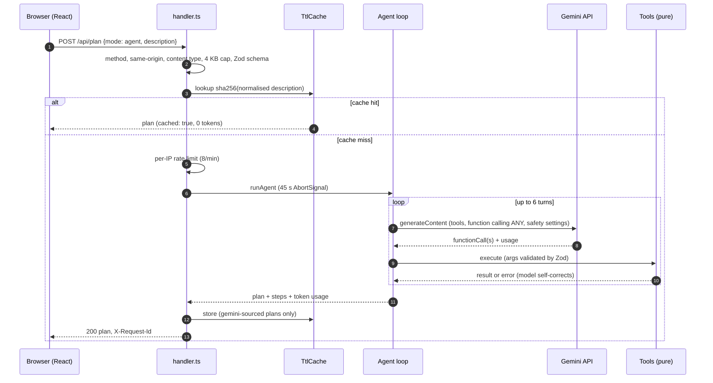

# EcoPilot architecture

This document explains how a request becomes a plan, and why each part is built the way it is.

## Principles

1. **The AI decides, the code computes.** Gemini understands free text and prioritises. Every number comes from pure, unit-tested functions in [`shared/tools.ts`](../shared/tools.ts).
2. **Untrusted input everywhere.** User text, model tool arguments and model text are validated with Zod before use.
3. **Always answer.** Model fallback, a deterministic narrative and demo mode mean the user gets a correct plan even when the AI provider fails.
4. **Measure, do not assume.** Latency, token usage, Lighthouse, axe and smoke tests are reported, not claimed.

## Request lifecycle (agent mode)

## Components

| Module                                            | Responsibility                                           | Key decisions                                                                                                                |
| ------------------------------------------------- | -------------------------------------------------------- | ---------------------------------------------------------------------------------------------------------------------------- |
| [`shared/factors.ts`](../shared/factors.ts)       | Emission factors with citations                          | One auditable file; also rendered on the Methodology page                                                                    |
| [`shared/tools.ts`](../shared/tools.ts)           | Footprint, benchmarks, action ranking, projection        | Pure and deterministic; overlap-safe projection never goes below zero                                                        |
| [`shared/schemas.ts`](../shared/schemas.ts)       | Zod contracts for requests, lifestyle and plan narrative | Shared by client, server and model tool validation                                                                           |
| [`server/agent.ts`](../server/agent.ts)           | Gemini function-calling loop                             | Numeric tools take no model arguments (they read server state); unknown action ids dropped; model fallback; token accounting |
| [`server/handler.ts`](../server/handler.ts)       | Framework-agnostic HTTP policy                           | Same code runs on Vercel, Cloud Run and the dev server, and is unit-tested directly                                          |
| [`server/cache.ts`](../server/cache.ts)           | TTL + LRU response cache                                 | Keys are SHA-256 of normalised text, so raw user text is never a key                                                         |
| [`server/rateLimit.ts`](../server/rateLimit.ts)   | Per-IP fixed window                                      | Bounded memory; per instance (see limitations)                                                                               |
| [`server/standalone.ts`](../server/standalone.ts) | Container / Cloud Run server                             | Reads security headers from `vercel.json`, so both hosts share one source of truth                                           |
| [`server/static.ts`](../server/static.ts)         | Static file resolution and header matching               | Path-traversal safe; tested with encoded and null-byte attacks                                                               |
| [`src/`](../src)                                  | React UI                                                 | Code-split views, lazy Motion features, Firebase started on first interaction                                                |

## Deployment targets

| Target           | How                                                                         | Notes                                   |
| ---------------- | --------------------------------------------------------------------------- | --------------------------------------- |
| Vercel           | `api/plan.ts` Web-standard function plus static `dist/`                     | Headers from `vercel.json`              |
| Google Cloud Run | [`Dockerfile`](../Dockerfile) → `node dist-server/standalone.js` on `$PORT` | Non-root, `/healthz`, graceful SIGTERM  |
| Local            | `npm run dev`                                                               | Vite middleware mounts the same handler |

## Failure handling

| Failure                                         | Behaviour                                                  |
| ----------------------------------------------- | ---------------------------------------------------------- |
| Primary model errors (quota, overload, retired) | Retry the same turn once on the fallback model             |
| Model fails after data was extracted            | Deterministic narrative (`source: fallback`)               |
| Model fails before any data                     | 422 with a user-safe message suggesting demo mode          |
| Request exceeds 45 s                            | AbortSignal cancels the in-flight call                     |
| Unexpected exception                            | Generic 500; details only in server logs with a request id |

## Known limitations

- The rate limiter and cache are per serverless instance. For multi-region scale, move both to a shared store such as Firestore or Memorystore.
- Emission factors are national and international averages; results are guidance, not certification.
